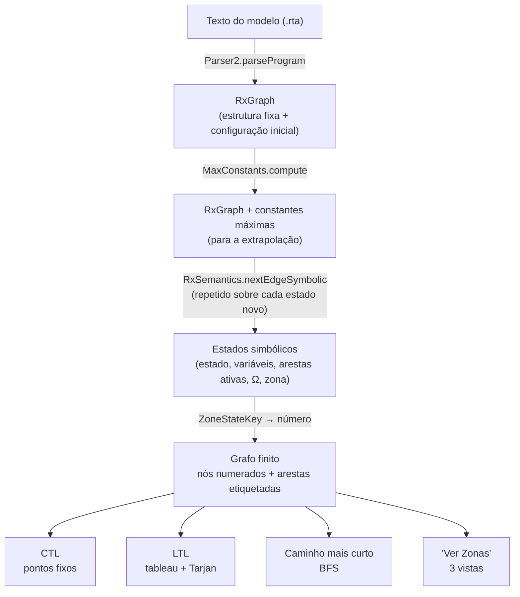
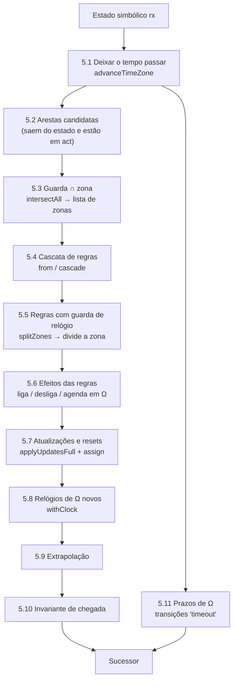

# Do Modelo RTA às Zonas — explicação detalhada

> Como é que a RTA Tool pega num modelo com **relógios, guardas, invariantes, hiper-arestas e delays** e o transforma num **grafo finito de zonas** onde se podem correr provas LTL, CTL e caminhos mais curtos.
>
> Todas as matrizes e estados deste documento foram **gerados pelo próprio motor**, a partir do modelo da secção 1. Não são ilustrações feitas à mão.

---

## Índice

0. [O mapa geral](#0-o-mapa-geral)
1. [O modelo de exemplo](#1-o-modelo-de-exemplo)
2. [Etapa 1 — do texto ao RxGraph](#2-etapa-1--do-texto-ao-rxgraph)
3. [O estado simbólico: o que é um "nó" do grafo de zonas](#3-o-estado-simbólico-o-que-é-um-nó-do-grafo-de-zonas)
4. [A zona: como se guarda uma DBM](#4-a-zona-como-se-guarda-uma-dbm)
5. [Etapa 2 — calcular os sucessores de um estado simbólico](#5-etapa-2--calcular-os-sucessores-de-um-estado-simbólico)
6. [O exemplo passo a passo](#6-o-exemplo-passo-a-passo)
7. [Etapa 3 — do grafo de estados simbólicos a um grafo "só de zonas"](#7-etapa-3--do-grafo-de-estados-simbólicos-a-um-grafo-só-de-zonas)
8. [Porque é que o grafo pode ficar enorme](#8-porque-é-que-o-grafo-pode-ficar-enorme)
9. [O que este método não faz (limitações)](#9-o-que-este-método-não-faz-limitações)
10. [Resumo de uma página](#10-resumo-de-uma-página)

---

## 0. O mapa geral



| Etapa | O que entra | O que sai | Onde está no código |
|---|---|---|---|
| 1. Leitura | texto | `RxGraph` | [`Parser2.scala`](../../shared/src/main/scala/rta/syntax/Parser2.scala), [`Program2.scala`](../../shared/src/main/scala/rta/syntax/Program2.scala) (`RxGraph`) |
| 2. Semântica simbólica | um estado simbólico | os seus sucessores | [`RxSemantics.scala`](../../shared/src/main/scala/rta/backend/RxSemantics.scala) (`nextEdgeSymbolic`, `advanceTimeZone`, `intersectAll`, `from`) |
| — Zonas | uma zona + uma operação | outra zona | [`DBM.scala`](../../shared/src/main/scala/rta/backend/DBM.scala) |
| 3. Grafo finito | estados simbólicos | nós numerados + arestas | [`CtlEvaluator.scala`](../../shared/src/main/scala/rta/backend/CtlEvaluator.scala) (`verifyCTLSymbolic`), [`LtlModelChecker.scala`](../../shared/src/main/scala/rta/backend/LtlModelChecker.scala) (`verify`), [`AnalyseLTS.scala`](../../shared/src/main/scala/rta/backend/AnalyseLTS.scala) (caminhos) |

**A ideia central:** o tempo contínuo é substituído por **zonas**, que são conjuntos de valores possíveis dos relógios. Tudo o resto (o estado atual, as variáveis, **que arestas estão ligadas** e **que regras com atraso estão pendentes**) fica **dentro de cada nó**. Assim as hiper-arestas e os delays não desaparecem: passam a fazer parte da identidade dos nós.

---

## 1. O modelo de exemplo

O modelo usa todos os ingredientes ao mesmo tempo:

```rta
clock x
int n[0..2] = 0
init A
inv B: x <= 5

A ---> B: entra if (x >= 1) then { x' := 0; n' := n + 1 }
B ---> C: sai disabled if (x >= 3 OR n >= 2)
B ---> A: volta if (x <= 1)
C ---> A: reinicia then { x' := 0 }

entra ->> sai: abre
delay abre: 2
entra --! volta: fechaVolta if (x >= 4)
reinicia ->> volta: abreVolta
reinicia --! sai: fechaSai
```

| Ingrediente | Onde aparece |
|---|---|
| Guarda com relógio | `entra` (`x >= 1`), `volta` (`x <= 1`) |
| Guarda com `OR` mistura relógio e dados | `sai` (`x >= 3 OR n >= 2`) |
| Invariante | `inv B: x <= 5` (não se pode ficar em `B` mais de 5) |
| Reset de relógio | `entra` e `reinicia` (`x' := 0`) |
| Variável limitada | `n[0..2]` |
| Aresta que começa desligada | `sai disabled` |
| Regra **com atraso** | `abre`: quando `entra` dispara, liga `sai`, mas só 2 unidades de tempo depois |
| Regra **com guarda de relógio** | `fechaVolta`: quando `entra` dispara, desliga `volta`, mas só se `x >= 4` nesse instante |
| Regras que repõem | `abreVolta` religa `volta`; `fechaSai` volta a desligar `sai` |

---

## 2. Etapa 1 — do texto ao RxGraph

`Parser2.parseProgram` lê o texto e constrói um `RxGraph` ([`Program2.scala`](../../shared/src/main/scala/rta/syntax/Program2.scala), `case class RxGraph`). A estrutura tem duas partes.

**Parte fixa** (descreve o modelo; nunca muda durante a análise):

| Campo | Conteúdo no exemplo |
|---|---|
| `edg` | arestas normais: `A-entra->B`, `B-sai->C`, `B-volta->A`, `C-reinicia->A` |
| `on` | regras "liga": `entra ->> sai : abre`, `reinicia ->> volta : abreVolta` |
| `off` | regras "desliga": `entra --! volta : fechaVolta`, `reinicia --! sai : fechaSai` |
| `lbls` | etiqueta → arestas com essa etiqueta (ex.: `volta` → `B ---> A : volta`). É isto que as regras usam para saber **o que** ligar ou desligar. |
| `edgeConditions` | guarda de cada aresta **e de cada regra** |
| `edgeUpdates` | atualizações de cada aresta e de cada regra |
| `invariants` | `B → x <= 5` |
| `clocks` | `{x}` |
| `delays` | regra → **expressão** da duração: `abre → 2` |

**Parte variável** (a configuração; é isto que muda de passo para passo):

| Campo | Valor inicial |
|---|---|
| `inits` | `{A}` |
| `act` | todas as arestas e regras **menos** `sai` (está `disabled`) |
| `val_env` | `n = 0` (com limites `[0..2]`) |
| `zone` | `x = 0` |
| `pendingDelays` (Ω) | vazio |

**Uma regra também é uma aresta.** Internamente, `entra ->> sai : abre` é o tuplo `(entra, sai, abre, abre)`, ou seja (*etiqueta que dispara*, *etiqueta-alvo*, *id*, *etiqueta da regra*). Por isso uma regra pode estar ligada ou desligada (está ou não em `act`) e pode ser alvo de outras regras.

### 2.1 Constantes máximas

Antes de explorar, `RxSemantics.MaxConstants.compute` percorre todas as guardas e invariantes e regista, para cada relógio, **a maior constante com que é comparado**:

- no exemplo: `x` é comparado com 1, 3, 1, 4 e 5, logo **M(x) = 5**;
- se a constante for uma **variável** (ex.: `x > N`), M fica ∞, porque o valor só se sabe durante a execução;
- os relógios auxiliares de Ω recebem como M a sua própria duração (`effectiveMax`).

Estas constantes servem para a **extrapolação** (secção 5.9), que é o que garante que o grafo é finito.

---

## 3. O estado simbólico: o que é um "nó" do grafo de zonas

Um estado simbólico é **uma configuração discreta + uma zona**. No código, a identidade de um nó é a chave `ZoneStateKey` ([`AnalyseLTS.scala`](../../shared/src/main/scala/rta/backend/AnalyseLTS.scala)):

```scala
case class ZoneStateKey(
  inits:   Set[QName],                          // estado(s) atual(is)
  vars:    Map[QName, RuntimeValue],            // variáveis
  zone:    DBM.Zone,                            // valores possíveis dos relógios
  pending: Set[(Edge, String, QName, Double)],  // Ω: (regra, "on"/"off", relógio auxiliar, duração)
  act:     Edges                                // arestas e regras ligadas
)
```

Dois estados simbólicos são **o mesmo nó** se, e só se, estes cinco campos forem iguais. É por isso que:

| Ingrediente do modelo | Como fica representado no nó |
|---|---|
| Tempo (relógios do utilizador) | `zone` |
| Hiper-arestas (o que está ligado agora) | `act` |
| Delays (regras à espera) | `pending` + um **relógio auxiliar por entrada**, dentro de `zone` |
| Dados | `vars` |
| Localização | `inits` |

O mesmo estado `B` com `volta` ligada ou desligada são **dois nós diferentes**. O mesmo estado com um pendente a mais também é outro nó.

---

## 4. A zona: como se guarda uma DBM

### 4.1 O que é

Uma zona é um conjunto de valores dos relógios descrito por restrições `cᵢ − cⱼ ≤ k` (ou `< k`). Com o relógio fictício `0`, que vale sempre zero, isto cobre também limites simples: `x ≤ 5` é `x − 0 ≤ 5`, e `x ≥ 1` é `0 − x ≤ −1`.

### 4.2 Como se guarda

[`DBM.scala`](../../shared/src/main/scala/rta/backend/DBM.scala) guarda uma matriz **n × n** em dois arrays planos: `vals` (o número) e `strs` (estrito `<` ou não `≤`). A célula da linha `i`, coluna `j` diz **cᵢ − cⱼ ≤ / < valor**. A ordem dos relógios é sempre a mesma (o `0` primeiro, depois por nome), de modo que duas zonas iguais têm arrays iguais. Por isso comparar e fazer *hash* de zonas é barato.

Exemplo (o estado inicial depois de deixar o tempo passar):

|   | 0 | x |
|---|---|---|
| **0** | ≤ 0 | ≤ 0 |
| **x** | ∞ | ≤ 0 |

- linha `x`, coluna `0`: `x − 0 ≤ ∞`, ou seja, `x` não tem limite superior;
- linha `0`, coluna `x`: `0 − x ≤ 0`, ou seja, `x ≥ 0`.

**Forma canónica:** depois de cada operação, cada célula guarda o limite **mais apertado** que se consegue deduzir. Isto é o algoritmo de Floyd-Warshall (`close`). Com a forma canónica:
- duas zonas iguais têm sempre a mesma matriz;
- uma zona é **vazia** quando algum elemento da diagonal fica negativo (`isSatisfiable`).

### 4.3 As operações (todas em `DBM.Zone`)

| Operação | Efeito na matriz | Usada para |
|---|---|---|
| `delay` | põe ∞ em toda a coluna `0` (os limites superiores `cᵢ − 0`) | deixar o tempo passar |
| `constrain(i, j, k, estrito)` | aperta a célula `(i, j)` e propaga só pelos caminhos que passam por ela (O(n²)) | guardas, invariantes, prazos de Ω |
| `assign(x, v)` | `x` passa a valer `v`: a linha e a coluna de `x` copiam as do `0`, deslocadas de `v` | `x' := 0` |
| `withClock(d)` | acrescenta um relógio novo `d = 0` (cópia do `0`) | criar a entrada de Ω |
| `withoutClock(d)` | apaga a linha e a coluna de `d` | uma entrada de Ω venceu |
| `extrapolate(M)` | limites acima de `M(i)` passam a ∞; limites inferiores abaixo de `−M(j)` passam a `< −M(j)` | tornar o grafo finito |

---

## 5. Etapa 2 — calcular os sucessores de um estado simbólico

Tudo acontece em `RxSemantics.nextEdgeSymbolic(rx)` ([`RxSemantics.scala`](../../shared/src/main/scala/rta/backend/RxSemantics.scala)). Para um estado simbólico `rx`, faz os passos seguintes.



### 5.1 Deixar o tempo passar — `advanceTimeZone`

1. `zone.delay`: o tempo pode correr sem limite;
2. corta pela **invariante** do estado atual (no exemplo, em `B`: `x ≤ 5`);
3. corta cada relógio auxiliar de Ω pela **sua duração**: um pendente **não pode** passar do prazo; quando chega lá, tem de disparar;
4. extrapola.

A zona que daqui sai representa "todos os instantes em que, a partir deste estado, ainda posso fazer alguma coisa".

> **Nota:** o motor não cria nós "só de espera". A passagem de tempo é **absorvida** em cada transição. Cada sucessor representa "esperar um tempo qualquer permitido e depois disparar a transição".

### 5.2 Arestas candidatas

São as arestas `edg` que **saem do estado atual** e que **estão em `act`**. Uma aresta desligada simplesmente não é tentada.

### 5.3 Guarda ∩ zona — `intersectAll`

Cada átomo da guarda vira uma operação `constrain`:

| Átomo | Restrição na DBM |
|---|---|
| `x < c` | `(x, 0) < c` |
| `x <= c` | `(x, 0) ≤ c` |
| `x > c` | `(0, x) < −c` |
| `x >= c` | `(0, x) ≤ −c` |
| `x == c` | as duas anteriores com `≤` |
| `x != c` | **duas zonas**: `x < c` e `x > c` |
| `c < x`, … | invertido para a forma acima |
| átomo **só de dados** (`n >= 2`) | é avaliado: se for verdadeiro, a zona fica igual; se for falso, a zona é descartada |

Os conectivos combinam assim:
- `AND`: aplica um átomo a seguir ao outro;
- `OR`: devolve **a lista das zonas de cada lado**. Uma união de zonas não é, em geral, uma zona (não é convexa), por isso o resultado é uma **lista**, e **cada zona da lista dá um sucessor diferente**.

Se a lista ficar vazia, a aresta não pode disparar a partir deste estado.

### 5.4 Cascata de regras — `from` / `cascade`

Quando uma aresta com etiqueta `e` dispara, `from(e)` recolhe **todas as regras ativas cuja etiqueta de disparo é `e`**. Se alguma regra tiver por alvo outra regra, a recolha continua a partir da etiqueta dessa regra, e assim sucessivamente, sem repetir regras. No exemplo, `from(entra) = {abre, fechaVolta}`.

### 5.5 Regras com guarda de relógio — `splitZones`

A guarda de uma regra é avaliada **no instante em que a aresta dispara**, ou seja, sobre a zona que saiu do passo 5.3, ainda antes dos resets.

- Guarda **sem relógios**: avalia-se e a regra dispara ou não.
- Guarda **com relógios**: a regra pode disparar para uns valores dos relógios e não para outros. A zona é **dividida em duas**: a parte em que a guarda é verdadeira (a regra dispara) e a parte em que é falsa (usa `negateCondition`; a regra não dispara).

Com `k` regras deste tipo podem sair até `2ᵏ` combinações. Cada combinação é um sucessor diferente.

### 5.6 Efeitos das regras

Para cada regra que disparou:

| Tipo de regra | Efeito |
|---|---|
| liga (`->>`) sem atraso | junta a `act` todas as arestas com a etiqueta-alvo |
| desliga (`--!`) sem atraso | retira de `act` essas arestas |
| com atraso (`delay regra: expr`) | **não mexe em `act` agora**. Calcula `expr` com as variáveis deste instante, escolhe um relógio auxiliar livre `__delay/k` (`freshSlot`) e acrescenta a Ω o tuplo `(regra, on/off, __delay/k, duração)` |

Se a mesma aresta for ligada e desligada no mesmo passo, ganha o desligar.

### 5.7 Atualizações e resets — `applyUpdatesFull` + `assign`

As atualizações da aresta e das regras que dispararam são executadas por ordem. Cada atribuição a um relógio (mesmo dentro de `if` ou de uma função) é registada, e na zona é aplicada `assign(x, valor)`.

### 5.8 Relógios novos de Ω — `withClock`

Cada entrada nova de Ω ganha o seu relógio auxiliar na zona, a começar em 0. A partir daqui esse relógio avança com o tempo, como os outros. O tempo que falta para o pendente vencer é `duração − valor do relógio`.

### 5.9 Extrapolação

Aplica-se `extrapolate(effectiveMax)`. Acima da constante máxima de cada relógio, os valores deixam de se distinguir, e é isto que impede o número de zonas de crescer para sempre.

### 5.10 Invariante de chegada

Se a zona de chegada não tiver nenhum valor compatível com a invariante do novo estado, o sucessor é descartado.

> A zona de chegada **não é cortada** pela invariante neste passo, só verificada. O corte acontece no passo 5.1 do estado seguinte. Por isso, nas tabelas de "chegada" pode aparecer um valor acima da invariante, e na de "depois de deixar o tempo passar" já não.

### 5.11 Prazos de Ω — transições `timeout`

Para cada pendente cujo relógio auxiliar pode chegar à duração, há uma transição especial:
1. fixa o relógio auxiliar **exatamente** na duração;
2. aplica o efeito da regra a `act` (liga ou desliga as arestas-alvo);
3. retira a entrada de Ω e apaga o relógio auxiliar (`withoutClock`);
4. extrapola.

O estado do modelo **não muda**. É uma transição "interna", com o id `timeout` e a etiqueta da regra, e na interface aparece como `⏱ regra`.

---

## 6. O exemplo passo a passo

Notação: `d0`, `d1`, … são os relógios auxiliares `__delay/0`, `__delay/1`, …

### S0 — início em `A`

| Campo | Valor |
|---|---|
| estado | A |
| n | 0 |
| desligadas | `sai` |
| Ω | — |

Zona à chegada (`x = 0`):

|   | 0 | x |
|---|---|---|
| **0** | ≤ 0 | ≤ 0 |
| **x** | ≤ 0 | ≤ 0 |

**5.1 Deixar o tempo passar.** `A` não tem invariante, por isso `x ≥ 0` sem limite:

|   | 0 | x |
|---|---|---|
| **0** | ≤ 0 | ≤ 0 |
| **x** | ∞ | ≤ 0 |

**5.2 Arestas candidatas:** só `entra` (sai de `A` e está ligada).

**5.3 Guarda `x >= 1`:** a célula `(0, x)` passa a `≤ −1`, ou seja, `x ≥ 1`:

|   | 0 | x |
|---|---|---|
| **0** | ≤ 0 | ≤ −1 |
| **x** | ∞ | ≤ 0 |

**5.4 Cascata:** `from(entra) = {abre, fechaVolta}`.

**5.5 Divisão pela guarda de `fechaVolta` (`x >= 4`).** A zona parte-se em duas:

Parte em que `fechaVolta` **dispara** (`x ≥ 4`):

|   | 0 | x |
|---|---|---|
| **0** | ≤ 0 | ≤ −4 |
| **x** | ∞ | ≤ 0 |

Parte em que `fechaVolta` **não dispara** (`1 ≤ x < 4`):

|   | 0 | x |
|---|---|---|
| **0** | ≤ 0 | ≤ −1 |
| **x** | < 4 | ≤ 0 |

**5.6 a 5.8**, em cada metade:
- `abre` tem atraso, por isso entra em Ω `(abre, on, d0, 2)` e `d0` começa em 0;
- `fechaVolta` só existe na metade da esquerda e desliga `volta`;
- `x' := 0`, `n' := 1`.

Resultado: **dois sucessores** com a mesma zona, mas com `act` diferente:

| Nó | Estado | n | Desligadas | Ω |
|---|---|---|---|---|
| **S1** | B | 1 | `sai`, **`volta`** | (abre, on, d0, 2) |
| **S2** | B | 1 | `sai` | (abre, on, d0, 2) |

Zona à chegada de ambos (`x = d0 = 0`):

|   | 0 | d0 | x |
|---|---|---|---|
| **0** | ≤ 0 | ≤ 0 | ≤ 0 |
| **d0** | ≤ 0 | ≤ 0 | ≤ 0 |
| **x** | ≤ 0 | ≤ 0 | ≤ 0 |

> **Aqui está a hiper-aresta com guarda de relógio a funcionar:** o que decide se `volta` fica ligada é o tempo que se esperou em `A`. Como esse tempo é uma zona, o motor parte-a e cria um nó para cada caso.

### S2 — em `B`, com `volta` ligada e `abre` pendente

**5.1 Deixar o tempo passar.** A invariante de `B` diz `x ≤ 5`, mas o prazo de `abre` diz `d0 ≤ 2`. Como `x − d0 = 0` (os dois relógios começaram juntos), também `x ≤ 2`:

|   | 0 | d0 | x |
|---|---|---|---|
| **0** | ≤ 0 | ≤ 0 | ≤ 0 |
| **d0** | ≤ 2 | ≤ 0 | ≤ 0 |
| **x** | ≤ 2 | ≤ 0 | ≤ 0 |

(Repare-se nas células `(d0, x) ≤ 0` e `(x, d0) ≤ 0`: dizem que `d0 = x`. É uma **restrição de diferença**, e é por isso que se usa uma matriz e não só intervalos.)

Sucessores:
- `volta` (guarda `x ≤ 1`) → **S4**: volta para `A` com o pendente **ainda vivo**;
- `⏱ abre` (prazo `d0 = 2`) → **S5**: liga `sai`, apaga `d0`, fica `x = 2`.

| Nó | Estado | Desligadas | Ω | Zona à chegada | Depois do tempo |
|---|---|---|---|---|---|
| S5 | B | — (tudo ligado) | — | `x = 2` | `2 ≤ x ≤ 5` (a invariante trava) |

Em S5, `sai` está ligada e a guarda `x >= 3 OR n >= 2` (com n = 1, só conta o lado do relógio) dá `x ∈ [3, 5]`: sucessor **S9** em `C`.

### S4 → S8 — o pendente sobrevive e acumula

Em **S4** (`A`, com `(abre, d0, 2)` ainda pendente), a zona à chegada é `0 ≤ x = d0 ≤ 1`. Se `entra` disparar outra vez antes de `abre` vencer, é criado **um segundo pendente**, com outro relógio auxiliar. Resultado: **S8**, com dois pendentes.

**S8**: estado B, n = 2, Ω = (abre, d0, 2), (abre, d1, 2). Zona à chegada:

|   | 0 | d0 | d1 | x |
|---|---|---|---|---|
| **0** | ≤ 0 | ≤ −1 | ≤ 0 | ≤ 0 |
| **d0** | ≤ 2 | ≤ 0 | ≤ 2 | ≤ 2 |
| **d1** | ≤ 0 | ≤ −1 | ≤ 0 | ≤ 0 |
| **x** | ≤ 0 | ≤ −1 | ≤ 0 | ≤ 0 |

Lê-se assim:
- o primeiro pendente já correu entre 1 e 2 (`1 ≤ d0 ≤ 2`);
- o segundo acabou de começar (`d1 = x = 0`).

Cada entrada de Ω traz o seu relógio, e a zona passa de 2×2 para 4×4.

### S17 — um `OR` dá dois sucessores sobrepostos

Em **S17** (B, n = 2, `volta` desligada, Ω vazio), a zona depois do tempo é `2 ≤ x ≤ 5`, e a guarda de `sai` é `x >= 3 OR n >= 2`:

- lado `x >= 3` → zona `3 ≤ x ≤ 5` → **S26**;
- lado `n >= 2` → como n = 2 é verdadeiro, a zona inteira `2 ≤ x ≤ 5` → **S27**.

As duas zonas **sobrepõem-se** (S26 está contida em S27), mas são dois nós diferentes. É o preço de representar um `OR` exatamente.

### Visão de conjunto

O grafo completo do exemplo tem **150 estados simbólicos** (chega a haver 3 pendentes em Ω ao mesmo tempo), distribuídos por apenas **3 estados do modelo**. A vista **"Por estado"** do *Ver Zonas* mostra precisamente isso: 3 nós com o número de zonas de cada um.

---

## 7. Etapa 3 — do grafo de estados simbólicos a um grafo "só de zonas"

Os verificadores não trabalham com `RxGraph` diretamente. Constroem um grafo dirigido normal:

1. começam no estado inicial depois de deixar o tempo passar;
2. para cada estado simbólico novo, chamam `nextEdgeSymbolic` e deixam o tempo passar em cada sucessor;
3. dão a cada `ZoneStateKey` novo um número (`stateIndices` / `stateIndex`) e guardam a lista de adjacência (`adj`), com a etiqueta e o id de cada aresta;
4. param ao atingir o limite de estados (50 000 na interface) e assinalam o resultado como **limitado**.

O que sai é **apenas** isto:

```
nó 0 --entra--> nó 1
nó 0 --entra--> nó 2
nó 2 --volta--> nó 4
nó 2 --⏱ abre--> nó 5
...
```

Neste grafo já não há relógios, regras nem atrasos: tudo isso está "congelado" na identidade de cada nó. Os verificadores correm algoritmos de grafos comuns sobre ele:

| Verificador | Algoritmo sobre o grafo | Ficheiro |
|---|---|---|
| CTL | pontos fixos (`EF`, `AG`, `EU`, `AU`, …) sobre arrays de booleanos, um por nó | `CtlEvaluator.verifyCTLSymbolic` |
| LTL (Prova Exaustiva) | produto do grafo com o tableau da fórmula. Primeiro procura em largura um prefixo que já viole a fórmula; depois procura com Tarjan uma componente fortemente ligada que dê um laço violador e não seja Zeno | `LtlModelChecker.verify` |
| Path Optimizer (zonas) | BFS até ao estado ou condição-alvo | `AnalyseLTS.findShortestPathSymbolic` |

### 7.1 Condições sobre relógios nas fórmulas

Uma fórmula como `G [x <= 2]` pergunta sobre os valores de `x` em cada nó. Como um nó tem uma **zona**, `x <= 2` pode ser verdadeiro para uns valores e falso para outros. Para que a resposta seja exata, antes de construir o grafo **cada zona é dividida pelos átomos de relógio da fórmula** (`splitByConditions` na CTL e `split` na LTL). Assim, cada átomo fica totalmente verdadeiro ou totalmente falso em cada nó. Se o mesmo modelo for verificado com fórmulas diferentes, o grafo pode ter tamanhos diferentes.

---

## 8. Porque é que o grafo pode ficar enorme

Cada combinação diferente de (estado, variáveis, `act`, Ω, zona) é um nó. As fontes de crescimento, com exemplos reais do modelo acima:

| Causa | Exemplo | Efeito |
|---|---|---|
| **Regras com atraso que voltam a disparar antes de vencer** | S4 → S8: dois `abre` pendentes ao mesmo tempo | cada pendente acrescenta um relógio à zona; mais relógios dão muito mais zonas diferentes |
| **O mesmo Ω com nomes de relógio diferentes** | S19 e S22 são iguais em tudo exceto em `d0` contra `d1` | nós "gémeos" que o motor não junta |
| **Guardas com `OR`** | S26 e S27 | um sucessor por disjunto, mesmo que se sobreponham |
| **Regras com guarda de relógio** | S1 e S2 | até `2ᵏ` sucessores por transição |
| **Variáveis** | `n` = 0, 1, 2 | multiplica tudo pelo número de valores possíveis |
| **Constantes grandes** | `x <= 72` no exemploB | a extrapolação só junta zonas acima da constante máxima |

No **exemploB** da apresentação, a primeira causa domina. Cada passagem por `Reducao → Inflamacao → …` volta a agendar `voltaDoenca` e `voltaDoenca2` enquanto as anteriores ainda correm. Ω chega a ter 7 entradas (8 relógios na zona) e o espaço passa de 300 000 estados simbólicos, embora o modelo só tenha 6 estados. A vista "Por estado" junta-os nesses 6.

---

## 9. O que este método não faz (limitações)

- **Diagonais nas guardas:** uma guarda como `x - y < 3` ou `x < y` não é traduzida para uma restrição de diferença. A parte direita é avaliada com o valor concreto do relógio, que na exploração simbólica não tem significado.
- **`OR` em invariantes:** quando o tempo passa, uma invariante com `OR` sobre relógios fica só com o primeiro disjunto que tenha solução (uma invariante deve ser convexa, como no UPPAAL).
- **A passagem de tempo está dentro das transições:** não há nós "a meio da espera". As condições de relógio das fórmulas são avaliadas nos nós, depois de o tempo passar.
- **Nós gémeos de Ω:** pendentes iguais com relógios auxiliares de nome diferente não são identificados como o mesmo nó (secção 8).
- **Deadlock:** um nó sem sucessores é tratado como o fim do traço (semântica de traço finito).

---

## 10. Resumo de uma página

1. **Leitura:** o texto vira um `RxGraph`, com a estrutura fixa (arestas, regras, guardas, atualizações, invariantes, delays) e a configuração inicial.
2. **Estado simbólico:** estado + variáveis + **arestas ligadas** + **Ω** + **zona**. É a chave `ZoneStateKey`.
3. **Zona:** matriz de diferenças entre relógios (DBM), sempre na forma canónica. Cada entrada de Ω tem o seu relógio dentro da zona.
4. **Sucessores** (`nextEdgeSymbolic`):
   - deixar o tempo passar (invariante, prazos de Ω);
   - guarda ∩ zona (`OR` dá várias zonas);
   - cascata de regras;
   - regras com guarda de relógio partem a zona;
   - efeitos: ligar, desligar ou agendar em Ω;
   - atualizações e resets;
   - extrapolação;
   - verificação da invariante de chegada;
   - prazos de Ω viram transições `⏱`.
5. **Grafo final:** cada estado simbólico distinto recebe um número; as transições ficam numa lista de adjacência. As hiper-arestas e os delays passam a fazer parte da identidade dos nós.
6. **Verificação:** CTL, LTL e caminhos são algoritmos de grafos sobre esse grafo. As condições de relógio das fórmulas obrigam primeiro a dividir as zonas.
7. **Tamanho:** cresce com os pendentes simultâneos, os `OR`, as regras com guarda de relógio e as variáveis. O *Ver Zonas → Por estado* resume tudo por estado do modelo.
