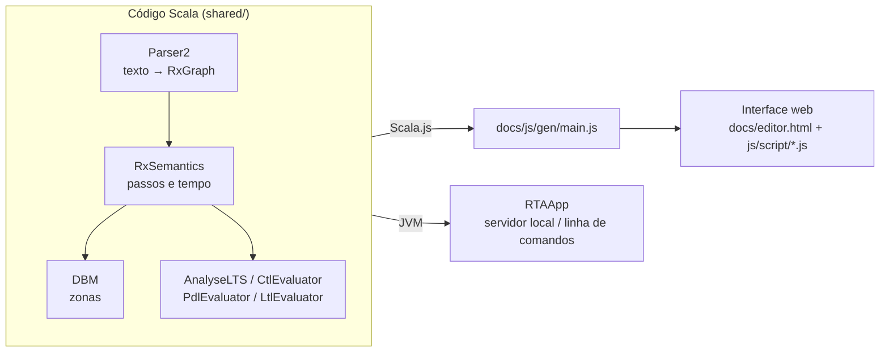
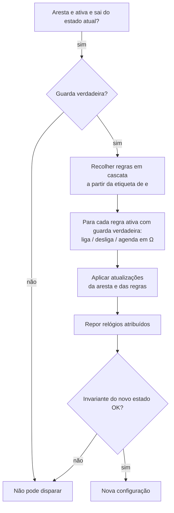
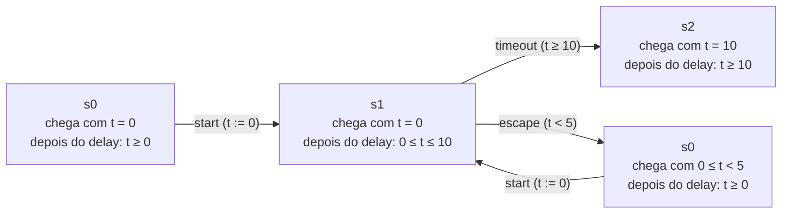

# RTA Tool — Guia de Apresentação

> Material de apoio para apresentar a ferramenta: o que é, como se usa, como funciona o motor por dentro e o que são as **zonas**.

---

## 1. O que é a RTA Tool

A RTA Tool serve para **modelar, simular e verificar sistemas reativos com tempo**.

Um modelo é um autómato normal (estados ligados por transições) com três ingredientes extra:

| Ingrediente | O que acrescenta | Exemplo |
|---|---|---|
| **Regras (hiper-arestas)** | Uma transição pode **ligar ou desligar** outras transições quando dispara. O sistema reconfigura-se enquanto corre. | `bloquear --! abrir` |
| **Dados** | Variáveis (`int`, `float`, `bool`, arrays), guardas `if (...)` e atualizações `then { ... }`. | `if (tentativas < 3)` |
| **Tempo** | Relógios contínuos, invariantes de estado e atrasos nas regras. | `clock t`, `inv Aberta: t <= 5` |

A ideia em frase única: **"um autómato temporizado cujas próprias transições mudam ao longo da execução"**.

---

## 2. Arquitetura em 1 minuto



- **Todo o motor está escrito uma vez, em Scala** (`shared/`).
- O **Scala.js** compila esse código para JavaScript (`docs/js/gen/main.js`). A interface web chama-o através do objeto global `RTA` (`RTA.loadModel`, `RTA.takeStep`, `RTA.runLTLExhaustive`, …).
- Não há servidor: **tudo corre no browser**.
- Para recompilar o motor depois de mexer no Scala: `sbt rtaJS/fastLinkJS`.

---

## 3. Como mexer na aplicação

### 3.1 Mapa da interface

```
┌──────────────────────────────────────────────────────────────────────────┐
│ File  Edit  View  Tools  Help            [Load & Simulate]  [Undo]       │
├──────────────┬───────────────────────────────────────┬───────────────────┤
│  PROJETO     │  Editor | Graph | Mermaid | Text       │ SIM | PDL | LTL | │
│  Exemplos    │                                        │ CTL               │
│  Meus        │   (código do modelo ou grafo           │                   │
│  Ficheiros   │    interativo)                         │  estado atual,    │
│              │                                        │  transições,      │
│              ├────────────────────────────────────────┤  delay, watch,    │
│              │ Analysis | Path Optimizer | Export |   │  breakpoints      │
│              │ Trace                                  │                   │
└──────────────┴────────────────────────────────────────┴───────────────────┘
```

| Zona | Para que serve |
|---|---|
| **Projeto** (esquerda) | Exemplos incluídos e ficheiros guardados no browser. Clicar num exemplo abre-o no editor. |
| **Editor** | Escrever o modelo. **F5** ou **EXECUTAR MODELO** carrega-o no motor. |
| **Graph (Interactive)** | O modelo desenhado: estados (círculos), transições (setas com etiqueta), regras (setas azuis = ligar, vermelhas = desligar). Arestas tracejadas estão **inativas**. Há vistas extra: *Current (Simple)*, *Zone Graph (DBM)* e *All Steps (LTS)*. |
| **Mermaid / Text** | O mesmo estado em diagrama Mermaid ou em texto. |
| **SIM** (direita) | Simulação passo a passo: valores dos relógios e variáveis, **regras agendadas (Ω)**, botões das transições ativas e o botão **⏱ Delay**. Inclui *Watch* (expressões a observar) e *Breakpoints*. |
| **PDL / LTL / CTL** | Verificadores de propriedades (secção 6). Os botões coloridos inserem nomes de estados, arestas e operadores na fórmula. |
| **Analysis** | *Statistics*, *Check Problems* (deadlocks, arestas inalcançáveis, regras contraditórias) e provas de equivalência ReTA ↔ ReGA. |
| **Path Optimizer** | Caminho mais curto até um estado ou até uma condição (ex.: `counter == 5`), com motor **simbólico (zonas)** ou **discreto (passos)**. |
| **Export** | UPPAAL, TikZ, SVG, PNG. |
| **Trace** | Gravação da simulação: lista de passos, reprodução (*Play*) e gráfico dos relógios e variáveis ao longo do tempo. |

### 3.2 Roteiro de demonstração (5 minutos)

1. Abrir o exemplo **TIMER.Re** e carregar (F5).
2. Separador **Graph**: mostrar `s0 → s1 → s2`, a invariante `t <= 10` em `s1` e as guardas.
3. **SIM**:
   - clicar `start`;
   - pôr `3` no campo do delay e carregar **⏱ Delay**: `t` passa para 3 e `escape` (guarda `t < 5`) fica ativa;
   - fazer mais um delay de 3: com `t = 6`, `escape` desaparece;
   - um delay de 5 é recusado, porque violaria `t <= 10`.
4. **Trace**: mostrar o gráfico de `t` (sobe na diagonal e cai a pique quando é reposto).
5. **CTL**: `EF s2` → verdadeira, com o caminho testemunha `start ➔ timeout` animado no grafo.
6. **CTL**: `AG [t <= 10]` → falsa, porque em `s0` e `s2` o relógio não tem limite.
7. **Path Optimizer**: alvo `s2`. O motor simbólico devolve `start, timeout` e o discreto devolve `start, delay(10), timeout`.

---

## 4. A linguagem em 5 minutos

```rta
clock t
int tentativas = 0
init Fechada
inv Aberta: t <= 5

Fechada --> Aberta: abrir if (tentativas < 3) then {
  t' := 0
  tentativas' := tentativas + 1
}
Aberta --> Fechada: fechar
Aberta --> Alarme: alarme if (t >= 5)
Alarme --> Fechada: rearmar disabled

alarme --! abrir: bloqueia
alarme ->> rearmar: permiteRearmar
rearmar ->> abrir: desbloqueia
delay desbloqueia: 2 * tentativas
```

Leitura do modelo:
- A porta abre (no máximo 3 vezes) e tem de fechar em menos de 5 unidades de tempo. Se não fechar, dispara o `alarme`.
- O alarme **desliga** `abrir` e **liga** `rearmar`.
- Quando se rearma, `abrir` **volta a ligar-se**, mas só `2 * tentativas` unidades de tempo depois. É uma regra com atraso.

### Resumo da sintaxe

| Elemento | Sintaxe |
|---|---|
| Estado inicial | `init s0` |
| Relógios | `clock t, u` |
| Variáveis | `int n = 0`, `int n[0..10] = 0`, `float r = 0.5`, `bool ok = true`, `int[] v = [1,2]`, `dyn int[] fila = []` |
| Invariante | `inv s1: t <= 10` |
| Transição | `s0 --> s1: etiqueta [disabled] [if (guarda)] [then { ... }]` |
| Transição com id | `s0 -id-> s1: etiqueta` |
| Regra liga | `a ->> b` (quando `a` dispara, liga as arestas com etiqueta `b`) |
| Regra desliga | `a --! b` (ou `a --x b`) |
| Atalhos | `a ----> b` (liga `b` e desliga-se a si própria), `a --#-- b` (exclusão mútua) |
| Regra com atraso | `delay nomeDaRegra: expressão` |
| Atualização | `x' := x + 1`; reposição de relógio: `t' := 0` |
| Funções | `def f(a, b) { ... return ... }`; também há `floor`, `ceil`, `round`, `abs`, `sqrt`, `pow`, `min`, `max`, `mod`, `clamp`, `random` |
| Módulos | `aut Nome { ... }`; os nomes ficam com prefixo, ex.: `Nome.s0` |

**Ponto importante:** as regras ligam etiquetas a etiquetas, não estados a estados. Também podem apontar para outras regras e, quando isso acontece, os efeitos propagam-se em **cascata**.

---

## 5. Como o motor funciona

### 5.1 O que é uma configuração

Em cada instante, o motor guarda uma **configuração** (`RxGraph` no código) com:

| Componente | Significado |
|---|---|
| `inits` | estado(s) atual(is); pode haver mais do que um quando se usam módulos `aut` |
| `act` | conjunto das arestas e regras **ativas** neste momento |
| `val_env` | valores das variáveis |
| `clock_env` | valores concretos dos relógios (usado na simulação) |
| `zone` | conjunto de valores possíveis dos relógios (usado na verificação, ver secção 6) |
| `pendingDelays` (**Ω**) | regras com atraso que já dispararam e ainda estão à espera |

A estrutura do modelo (arestas, regras, guardas, atualizações, invariantes) nunca muda. O que muda de passo para passo é **`act`**, os dados, o tempo e Ω.

### 5.2 Um passo discreto (disparar uma transição)



Regras do jogo:
- As guardas das regras são avaliadas **antes** das atualizações. Todas as regras de um passo veem o mesmo estado de partida.
- Se no mesmo passo uma aresta for **ligada e desligada**, ganha o **desligar**. O *Check Problems* assinala estes casos como inconsistências.
- A cascata não entra em ciclo: cada regra conta uma única vez por passo.

### 5.3 O tempo e a lista de pendentes Ω

- Fazer **delay d** aumenta todos os relógios em `d`, desde que nenhuma invariante do estado atual fique violada.
- Uma regra com atraso (`delay r: expr`) não atua de imediato. Quando dispara, calcula `expr` com os valores **desse instante** e entra em Ω com esse tempo.
- **Cada delay desconta o tempo a todos os pendentes.** O que chega a 0 aplica o seu efeito (liga ou desliga) e sai de Ω.
- Um delay maior do que o prazo de um pendente não fica bloqueado: o tempo pára nesse prazo, a regra dispara e o resto do delay continua.
- A mesma regra pode estar várias vezes em Ω, se disparar várias vezes.

Exemplo, com `delay e1: k` e `delay e2: 2`:

| Momento | Ω |
|---|---|
| depois de `a` (k=3), `b`, `a` (k=4) | (e1, 3), (e2, 2), (e1, 4) |
| depois de `delay 1.6` | (e2, 0.4), (e1, 1.4), (e1, 2.4) |
| depois de `delay 0.5` | `e2` disparou → restam (e1, 0.9), (e1, 1.9) |

Internamente, cada entrada de Ω tem um relógio auxiliar próprio (`__delay/0`, `__delay/1`, …). Esse relógio começa em 0 quando a regra dispara, e o tempo restante é `duração − relógio`. Isto faz com que Ω funcione tanto na simulação como na verificação por zonas. Estes relógios não aparecem na interface.

---

## 6. Zonas: como se verifica um sistema com tempo contínuo

### 6.1 O problema

Na simulação escolhemos um valor concreto para cada delay (1, 3, 1.6, …). Para **provar** uma propriedade teríamos de testar **todos** os valores reais possíveis, que são infinitos. A solução clássica (a do UPPAAL) é trabalhar com **conjuntos** de valores de relógios em vez de valores soltos.

### 6.2 O que é uma zona

Uma **zona** é um conjunto de valores dos relógios descrito só por restrições deste tipo:

- `x ≤ 5`, `x > 2` (um relógio contra uma constante);
- `x − y ≤ 3` (diferença entre dois relógios).

Com dois relógios `x` e `y`, uma zona é um polígono convexo no plano:

```
 y
 │        ╱
 4 ┤    ╱░░╱        zona:  1 ≤ x ≤ 4
   │  ╱░░░╱                0 ≤ y
 2 ┤ ╱░░░╱                 0 ≤ x − y ≤ 1
   │╱░░░╱
 0 ┼────┬────┬── x
   0    2    4
```

### 6.3 Como se guarda: a DBM

Uma zona guarda-se numa **DBM (Difference Bound Matrix)**: uma matriz em que a célula `(i, j)` diz "**cᵢ − cⱼ ≤ valor**" (ou `<`). Usa-se um relógio fictício `0`, sempre igual a zero, para exprimir limites simples.

Exemplo (a zona do desenho acima): `1 ≤ x ≤ 4`, `0 ≤ y` e `0 ≤ x − y ≤ 1`.

|        | 0      | x      | y      |
|--------|--------|--------|--------|
| **0**  | ≤ 0    | ≤ −1   | ≤ 0    |
| **x**  | ≤ 4    | ≤ 0    | ≤ 1    |
| **y**  | ≤ 4    | ≤ 0    | ≤ 0    |

Como se lê:
- A linha `x`, coluna `0` diz `x − 0 ≤ 4`, ou seja, `x ≤ 4`.
- A linha `0`, coluna `x` diz `0 − x ≤ −1`, ou seja, `x ≥ 1`.

No código, isto está em [`shared/src/main/scala/rta/backend/DBM.scala`](../../shared/src/main/scala/rta/backend/DBM.scala).

### 6.4 As operações sobre zonas

| Operação | O que faz | Quando é usada |
|---|---|---|
| **delay** (passagem de tempo) | Apaga os limites superiores (`x ≤ c` passa a `x ≤ ∞`). Todos os relógios andam juntos, por isso as diferenças mantêm-se. | Ao entrar num estado: "deixar o tempo correr" |
| **constrain** (interseção) | Junta uma restrição (`x ≥ 5`) e propaga as consequências. Se a zona ficar vazia, a transição é impossível. | Guardas e invariantes |
| **reset / assign** | `x := 0`: `x` passa a valer exatamente 0. A relação de `x` com os outros relógios passa a ser a do relógio `0`. | Atualizações `t' := 0` |
| **canonicalização** | Algoritmo de Floyd-Warshall: aperta cada limite ao mais justo possível (caminhos mais curtos). Permite comparar zonas e detetar zonas vazias (ciclo negativo na diagonal). | Depois de cada operação |
| **extrapolação** | Acima da maior constante com que um relógio é comparado (M), o valor exato deixa de importar ("t > 10" já chega). Os limites acima de M passam a ∞. | Garante que o número de zonas é **finito** |

Uma guarda com `OR` (ex.: `x < 1 OR x > 5`) não cabe numa só zona, porque não é convexa. Por isso o motor divide-a em **várias zonas**, uma por disjunto, e cada uma dá origem a um sucessor.

### 6.5 O grafo de zonas

Um **estado simbólico** é um par *(configuração discreta, zona)*. A partir de cada estado simbólico:

1. deixa-se o tempo passar (delay) e corta-se pela invariante do estado;
2. para cada transição ativa, intersecta-se a zona com a guarda;
3. aplicam-se as regras, as atualizações e os resets;
4. extrapola-se.

O resultado é um grafo **finito**, que se pode explorar por completo. Exemplo com o TIMER (vista *Zone Graph (DBM)* ou botão *Ver Zonas*):



Repare-se que `s0` aparece duas vezes: no início, com `t = 0`, e depois do `escape`, com `0 ≤ t < 5`. A localização é a mesma, mas a zona com que lá se chega é diferente. Como o `start` repõe `t`, os dois caminhos voltam a juntar-se em `s1`. Ao todo são 4 estados simbólicos, que representam as infinitas execuções concretas do modelo.

Uma propriedade que valha em **todas as zonas** alcançáveis vale para **qualquer** escolha de tempos reais. É por isso que a verificação simbólica dá **provas** e não apenas testes.

---

## 7. Os verificadores

| Separador | Pergunta típica | Como funciona |
|---|---|---|
| **PDL** | "Depois de `a; b`, chego a `fim`?" (`<a ; b> fim`) | Executa os programas (`;` sequência, `+` escolha, `*` repetição, `delay:5.0`) sobre configurações concretas a partir do estado escolhido. `[α]φ` é verdadeira quando α não se pode executar. |
| **LTL** | "Em todas as execuções, `fechar` acaba sempre por acontecer?" (`G F fechar`) | *Único / Estatístico*: avalia em traços aleatórios (rápido, sem garantia). *Prova Exaustiva*: explora o grafo de zonas à procura de um **laço** (lasso) ou de um deadlock que viole a fórmula. |
| **CTL** | "De qualquer estado ainda é possível chegar a `s2`?" (`AG EF s2`) | Constrói o grafo de zonas completo e calcula, para cada operador, o conjunto de estados onde a fórmula vale, por **ponto fixo**. Em `AG` falsa e em `EF` verdadeira mostra um caminho testemunha. |
| **Path Optimizer** | "Qual o caminho mais curto até `Alarme`?" | Pesquisa em largura (BFS): sobre zonas (simbólico) ou sobre valores concretos com delays escolhidos a partir das constantes das guardas (discreto). |

O que cada nome significa dentro de uma fórmula:
- **PDL:** `s1` quer dizer "estou no estado `s1`".
- **LTL:** um nome solto quer dizer "a aresta ou regra com esta etiqueta está **ativa**".
- **CTL:** um nome solto vale se for o estado atual **ou** uma etiqueta ativa.
- **Em todos:** condições sobre dados e relógios escrevem-se entre parênteses retos, ex.: `[t <= 10]` ou `[counter == 3]`.

Cuidados na prova LTL exaustiva:
- **Caminhos finitos:** um caminho que acaba num deadlock é avaliado como traço finito.
- **Execuções Zeno:** ciclos que obrigam a fazer infinitos passos num tempo limitado são ignorados.
- **Limite de estados ou de profundidade:** se for atingido, o resultado vem marcado como **limitado**. Nesse caso, um "verdadeiro" quer dizer "não encontrei violação dentro do limite".
- **CTL:** quando atinge o limite de estados, mostra um aviso de **resultado inconclusivo**.

---

## 8. Perguntas que costumam aparecer

**Qual é a diferença para o UPPAAL?**
O núcleo de tempo é o mesmo (zonas e DBM). O que a RTA acrescenta são as **regras que reconfiguram o autómato** enquanto corre e as regras com atraso. Também é possível exportar o modelo para UPPAAL (*Export → Uppaal*) e verificá-lo lá.

**Porque é que uma transição aparece tracejada?**
Está inativa: começou `disabled` ou foi desligada por uma regra.

**Porque é que o Delay foi recusado?**
Deixar passar esse tempo violaria a invariante do estado atual. É preciso disparar uma transição antes.

**O resultado da prova exaustiva é mesmo uma prova?**
Sim, se o espaço de zonas foi explorado por completo. Se o limite foi atingido, a interface indica-o e o resultado passa a valer só até esse limite.

**Onde está o código de cada parte?**

| Parte | Ficheiro |
|---|---|
| Parser | `shared/src/main/scala/rta/syntax/Parser2.scala` |
| Estrutura do modelo | `shared/src/main/scala/rta/syntax/Program2.scala` |
| Semântica (passos, tempo, Ω, grafo de zonas) | `shared/src/main/scala/rta/backend/RxSemantics.scala` |
| Zonas / DBM | `shared/src/main/scala/rta/backend/DBM.scala` |
| LTL exaustivo, caminhos, *Check Problems* | `shared/src/main/scala/rta/backend/AnalyseLTS.scala` |
| CTL | `shared/src/main/scala/rta/backend/CtlEvaluator.scala` |
| PDL | `shared/src/main/scala/rta/backend/PdlEvaluator.scala` |
| Ponte para a interface | `js/src/main/scala/marge/frontend/RTAAPI.scala` |
| Interface | `docs/editor.html`, `docs/js/script/*.js` |
